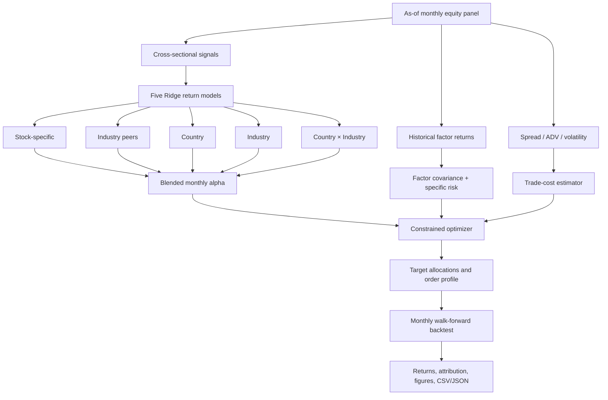
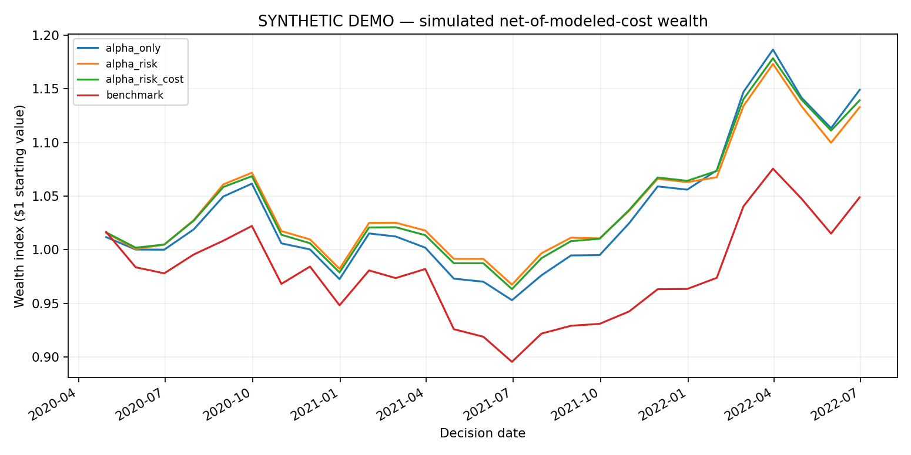
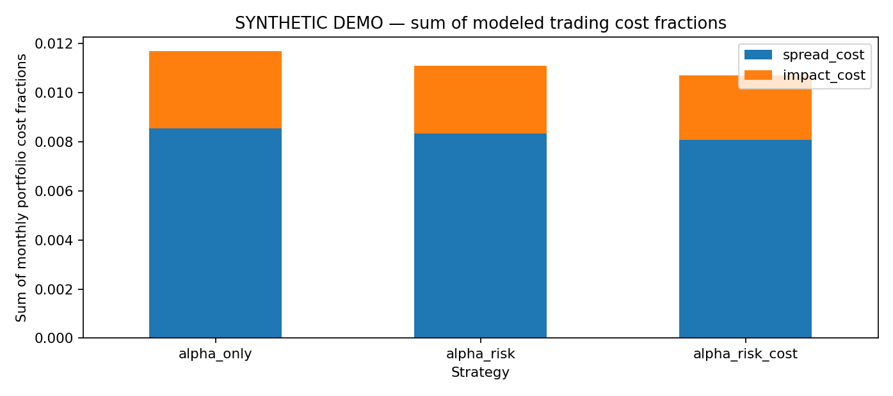

# Alpha–Risk–Cost: A Transparent Systematic Equity Research Framework

[](#tests-and-reproducibility)  

> **Research question:** When a bottom-up equity forecasting signal is converted into portfolio weights, how do benchmark-relative risk constraints and nonlinear trading costs affect positions, turnover, and realized net returns?
>
> **Scope:** This repository implements an **independent academic approximation** motivated by the publicly described investment process of Acadian Asset Management. It is **not Acadian source code, its investment advice, or a reproduction of its proprietary models.** The committed example uses **fictional simulated securities**, not historical performance.

## Read this first

- **[Research methodology](docs/METHODOLOGY.md)** — assumptions, five forecasting layers, risk factor mathematics, cost function, optimizer, and backtest accounting.
- **[Input data contract](docs/DATA_SCHEMA.md)** — precisely what each field means and how to avoid look-ahead, survivorship, and publication-lag biases.
- **[Experiments and interpretation](docs/EXPERIMENTS.md)** — control groups, results, sensitivity testing, and what can be concluded from synthetic data.
- **[Synthetic experiment report](examples/synthetic/EXPERIMENT_REPORT.md)** — generated results from the included fixed-seed demonstration.
- **[Tests](tests/)** — 47 unit/integration tests for mathematical, accounting, and data integrity; see current test run in CI.

## Overview of the research system



### Models and implementation — trace each concept to code

| Research component | Financial model / method | Implementation | Why it is there |
|---|---|---|---|
| As-of panel | Monthly decision dates, observable feature checks, strictly later return labels | `data.py`, `signals.py` | Avoid data leakage and make the information set explicit |
| Equity signals | Sector-relative winsorization, cross-sectional z-scores, leave-one-out peers | `signals.py` | Normalize and organize heterogeneous predictors |
| Expected returns | **Five separate StandardScaler + Ridge regressions** fitted on preceding months | `forecast.py` | Obtain a transparent, regularized five-layer forecast |
| Factor risk | Historical cross-sectional factor-return regressions, **Ledoit–Wolf** shrinkage, diagonal idiosyncratic variance | `risk.py` | Estimate portfolio tracking-error risk and explain factor contributions |
| Transaction costs | Half quoted-spread proxy + **participation-aware 3/2-power impact** | `costs.py` | Penalize portfolio changes, not just final holdings |
| Portfolio construction | Benchmark-relative **SLSQP** nonlinear optimization with analytical gradient and linear constraints | `optimizer.py` | Balance estimated alpha, risk, and trade costs |
| Monthly accounting | Lagged training, pretrade drift, cost deduction, alternative strategies | `backtest.py` | Evaluate the entire decision chain out of sample |
| Analytics | CAGR, active return, tracking error, information ratio, drawdown, Spearman rank IC | `metrics.py`, `reporting.py` | Report forecasts and portfolio outcomes separately |
| Command-line experiment | Deterministic synthetic generator and export pipeline | `cli.py` | Reproduce outputs without manual notebook steps |

**Terminology note:** The example uses `sector` as a coarse proxy for an industry peer group. The five forecast *layers* are structurally inspired by the public description, while feature sets, regression coefficients, blend weights, trading coefficients, and return-generating process are **our own research design**.

## The portfolio objective

At month $t$, choose target weights $w$ relative to benchmark $b$, with pretrade drifted holdings $p$, expected **monthly** returns $\hat\alpha$, and **monthly** stock covariance $\Sigma$:

$$
\underset{w}{\operatorname{maximize}}\quad
\hat\alpha^{\mathsf T}(w-b)
-\frac{\lambda}{2}(w-b)^{\mathsf T}\Sigma(w-b)
-\gamma\sum_i\left[
\frac{s_i}{20{,}000}|w_i-p_i|
+k\frac{\sigma_{i,\mathrm{month}}}{\sqrt{21}}
\sqrt{\frac{\mathrm{AUM}}{\mathrm{ADV}_i\,d}}
|w_i-p_i|^{3/2}\right].
$$

Where $s_i$ is the bid–ask spread in basis points (full spread), $d$ is assumed execution days, $k$ is an *illustrative* impact coefficient, and $\gamma$ controls use of forecast transaction costs in the objective. Portfolio costs are unitless fractions of AUM.

Subject to long-only, full-investment, max individual holding and active weight, sector-relative bounds, total gross turnover, and percentage-of-ADV participation limits. `optimizer.py` introduces \(u_i\ge |w_i-p_i|\) for turnover and participation constraints. The objective is convex in minimization form for positive-semidefinite \(\Sigma\), though numerical SLSQP convergence is not guaranteed for all admissible inputs. The implementation validates numerical feasibility after solving.

The optimizer uses **risk and cost forecasts** from past inputs, then the backtest subtracts **modeled** costs from realized next-period gross returns. This is *not* a fill simulator.

## What is actually implemented — and what is not

| Included and exercised | Not included / not established |
|---|---|
| Five regression-based alpha component models | Acadian's actual signals, model architecture, or signal weights |
| Factor exposures, shrinkage covariance, factor/specific risk attribution | Calibrated institutional proprietary risk model or a validated full Barra-style model |
| Nonlinear cost model and ADV constraints | Consolidated real quote/trade history, calibrated realized slippage, real trading |
| Long-only constrained optimizer and three strategy ablations | Short-selling, futures/FX hedging, tax lots, corporate actions |
| Multi-month walk-forward **synthetic** backtest with drifted positions | Survivorship-free global point-in-time equity history and a verified live-data backtest |
| Outputs, automated tests, and CI workflow | Any evidence of an investable strategy, predictive market alpha, or actual performance |

## Run locally

**Requirements:** Python >= 3.10. No brokerage credentials, APIs, or proprietary data required for the demo.

```bash
# From the repository root:
python -m venv .venv
# Linux/macOS:
source .venv/bin/activate
# Windows PowerShell:
# .venv\Scripts\Activate.ps1

python -m pip install -e '.[dev]'

# Cross-platform Python command:
python -m acadian_arc.cli --months 42 --seed 17 --output-dir reports/my-synthetic-run

# Or installed console entry point:
acadian-arc --months 42 --seed 17 --output-dir reports/my-synthetic-run

# Run test suite:
python -m pytest -q --cov=acadian_arc --cov-report=term-missing
```

If the local numerical backend is unusually slow, set `OPENBLAS_NUM_THREADS=1`, `OMP_NUM_THREADS=1`, and `MKL_NUM_THREADS=1` before Python starts. The test workflow does this on CI. For plotting on a headless server, set `MPLBACKEND=Agg`.

**Input your own panel** (after reading the bias warnings in [DATA_SCHEMA.md](docs/DATA_SCHEMA.md)):

```bash
acadian-arc --input-csv path/to/asof_monthly_panel.csv --output-dir reports/user-panel
```

This only accepts already-prepared monthly panel data. There is **no real-data downloader** or historical-universe builder. Loading a CSV does not validate that its economic history is unbiased.

## Reproducible outputs

The committed `examples/synthetic/` directory contains generated outputs, allowing visitors to inspect results without running anything:

| File | Contents |
|---|---|
| `EXPERIMENT_REPORT.md` | Human-readable synthetic demonstration findings and audit trail |
| `summary.json` | Strategy statistics, configuration and forecast IC |
| `stock_forecasts.csv` | Date, ticker, training cutoff, 5 component forecasts and next-month label |
| `risk_attribution.csv` | Model-implied active-variance decomposition by group |
| `portfolio_weights.csv` | Benchmark, pretrade, optimized weights and trade sizes |
| `transaction_costs.csv` | Estimated half-spread and impact components |
| `monthly_returns.csv` | Monthly strategy gross/net simple returns |
| `order_profile.csv` | Illustration of trade participation and execution buckets |
| `synthetic_wealth.png` | Net-of-model-cost portfolio wealth trajectories |
| `synthetic_costs.png` | Cumulative estimated cost comparison |

### Example output (synthetic data; **not actual investment performance**)





The initial 42-month fictional-universe experiment generated **27** out-of-sample monthly decisions (15 warm-up months). It showed the cost-aware model having somewhat lower modeled trading costs and turnover than the alternatives, but **not the highest realized synthetic CAGR**. This is a desirable transparent research outcome: it avoids asserting a guaranteed benefit from cost awareness. Exact metrics are in the report and depend on the fixed seed/configuration.

For instructions to publish this repository cleanly, see **[GitHub publishing guide](docs/GITHUB_GUIDE.md)**. For test details, see **[validation evidence](docs/VALIDATION.md)**.

## Repository map

```text
.
├── README.md
├── docs/
│   ├── METHODOLOGY.md          # Mathematical research methodology
│   ├── DATA_SCHEMA.md          # Expected input panel and bias controls
│   ├── EXPERIMENTS.md          # Tests, ablation design and interpretation
│   ├── VALIDATION.md           # Tests executed and coverage results
│   └── GITHUB_GUIDE.md         # Upload and presentation instructions
├── src/acadian_arc/
│   ├── data.py                 # Validation and fictional generator
│   ├── signals.py              # Normalization and peer engineering
│   ├── forecast.py             # Five regularized alpha models
│   ├── risk.py                 # Factor covariance and risk decomposition
│   ├── costs.py                # Spread + nonlinear market impact
│   ├── optimizer.py            # SLSQP portfolio optimizer
│   ├── backtest.py             # Walk-forward evaluation
│   ├── metrics.py              # Performance and rank IC
│   ├── reporting.py            # CSV, JSON, plots, report
│   └── cli.py                  # Reproducible command-line entry point
├── tests/                      # Unit and integration tests
├── configs/research.json      # Reproducible optimizer settings
├── examples/synthetic/         # Generated committed demonstration
├── .github/workflows/ci.yml    # CI on commits and pull requests
├── pyproject.toml
└── LICENSE
```

## Tests and reproducibility

Tests cover duplicate/invalid data, timestamp leakage checks, ridge training cutoff, peer construction, PSD risk, additive factor attribution, spread and impact arithmetic, position/sector/turnover/ADV constraints, expected cost monotonicity, and walk-forward accounting. Run `pytest` locally; GitHub Actions also runs tests on Python 3.10 and 3.12. A local validation run on Python 3.13 passed **47/47 tests, 94% statement coverage**, including CLI smoke testing. These results establish software behavior on the tested cases, **not financial validity**.

## Public evidence and intellectual provenance

Acadian's [May 19, 2026 SEC-hosted Investor Forum, especially slides 19–23](https://www.sec.gov/Archives/edgar/data/1748824/000162828026036160/a2026-masterfilexirforum.htm) describes a return-forecast/risk/cost/execution workflow. Slides and their numbers are **illustrative**. The [Investor Forum transcript](https://s25.q4cdn.com/824091080/files/doc_downloads/Downloads/aami-ir-forum-transcript.pdf) explains five underlying forecast categories: stock, peers, and country / industry / country-industry macro layers. Sources are for conceptual motivation only. All code, simplified specifications, synthetic dataset and calibration settings here are independently authored.

## Next empirical milestone

Build a licensed or public, correctly lagged **historical survivorship-free panel** with true benchmark holdings, fundamentals, returns including delistings, and liquidity. Then report 1-month rank IC, top-minus-bottom decile return, strategy comparison, AUM sensitivity, parameter sensitivity, drawdown and uncertainty intervals over distinct out-of-sample periods. Until then, this is a *tested research-software project*, not an empirically validated investment study.

**Disclaimer:** Educational research only; not endorsed by, affiliated with, or sponsored by Acadian. No investment recommendation. See [LICENSE](LICENSE).
