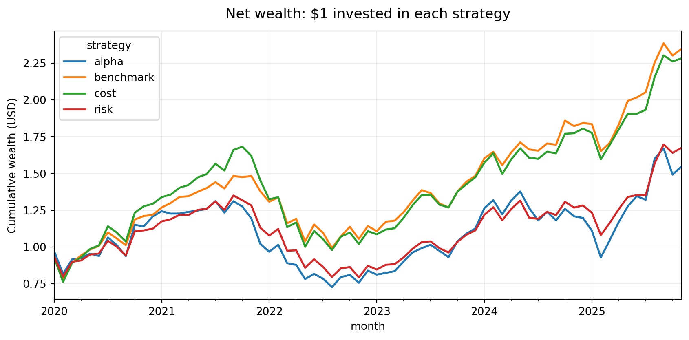
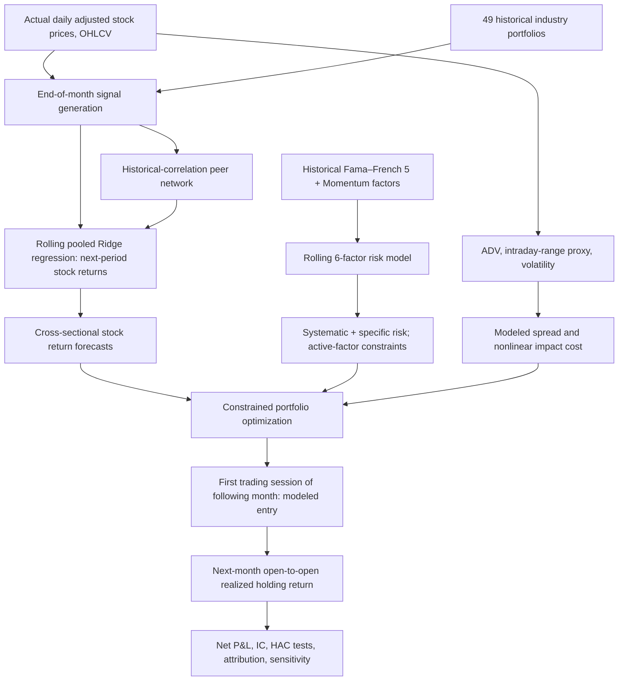

# Bottom-Up Equity Return Forecasting under an Explicit Alpha–Risk–Cost Objective

**An independent, reproducible US equity research implementation informed by Acadian Asset Management's publicly disclosed systematic investment framework.**

> **Empirical, not simulated:** 1,444,124 actual daily stock-price observations across 503 tickers (2015-01-02 to 2026-11-10), the Fama/French five factors, the momentum factor, and 49 industry return series. **Not an Acadian strategy, proprietary-model reconstruction, endorsement, or investable track record.** The price universe contains only today's S&P 500 members and therefore suffers from **survivorship bias**. The supplied data contain no stock-level fundamentals, quotes, or executions.



## 1. Research question

**Does the addition of explicit benchmark-relative factor risk and modeled liquidity-dependent transaction costs improve the implementability of bottom-up equity forecasts?** This question does **not** presume that forecast information coefficients, investment alpha, or net returns will be positive.

The investment-process mapping follows Acadian Asset Management Inc., *Investor Forum*, May 19, 2026, slides 19–23, Exhibit 99.2 [SEC filing](https://www.sec.gov/Archives/edgar/data/1748824/000162828026036160/a2026-masterfilexirforum.htm). The firm's examples are stylized, and its proprietary models are not available. Our models, signals, constraints, and hyperparameters are our own transparent research approximations.

## 2. Research architecture



## 3. Mathematical objective

Let `w` be proposed holdings, `b` equal-weight benchmark holdings, `w_prev` pre-trade drifted holdings, `alpha` expected next-holding-period returns and `Sigma` the forecast monthly covariance.

$$
\max_{\mathbf{w}}\; \widehat{\boldsymbol{\alpha}}^\top\mathbf{w}
-\frac{\lambda}{2}(\mathbf{w}-\mathbf{b})^\top\widehat{\Sigma}(\mathbf{w}-\mathbf{b})
-\mathcal{C}(\mathbf{w}-\mathbf{w}_{prev})
$$

Subject to full investment, nonnegative weights, 10% single-stock cap, active market-factor beta within ±0.15 and each of five nonmarket Fama/French style-factor exposures within ±0.30 (for risk-aware and cost-aware portfolios). The alpha-only ablation does not enforce the factor caps. The cost-aware objective embeds trade-cost estimates; **realized costs are charged to all portfolios for fair comparison.**

**Nonlinear cost proxy (fraction of NAV):**

$$
\mathcal{C}(\Delta\mathbf{w}) = \sum_i \left[ 0.25\,{\mathrm{Range}}_{20,i}|\Delta w_i| + 0.08\,\sigma_{m,i}\sqrt{\frac{\mathrm{AUM}}{\mathrm{ADV}_{20,i}}}|\Delta w_i|^{3/2}\right]
$$

Here `Range20` is median relative **daily high-to-low range**, *not an observed bid–ask spread*. `ADV20` is trailing 20-trading-day dollar volume. Assumed AUM is USD 10 million. Additional 50 bp liquidation cost is assumed on stocks leaving the eligible universe. No commissions, borrow fees, taxes, or actual trade-level slippage are observed.

## 4. Implemented components and model details

| Component | Implementation | Module | Model discipline |
|---|---|---|---|
| Data and alignment | Daily adjusted OHLCV → monthly panel; French archives parsed and converted from percent | `data.py` | Missing returns fail loudly; no forward fill |
| Stock alpha | 12-to-2 and 6-to-2 momentum, one-month reversal, low-volatility, intraday-range, liquidity | `data.py`, `models.py` | No fundamentals pretended; market beta not a direct alpha signal |
| Peer return model | Top-five historical-correlation neighbors from a historical 12-month lookback | `data.py` | Network formed only from past returns, current liquid candidates |
| Macro context | Past 6-month Fama/French market trend and past 3-month industry return dispersion interacted with momentum | `data.py` | Public index proxies, not Acadian country models |
| Forecast engine | Cross-sectional percentile ranks, expanding through each prior 48-month window, pooled Ridge (α=100) | `models.py` | Only labels available at portfolio decision time are used |
| Six-factor risk | Rolling stock-on-factor OLS exposures, Ledoit–Wolf shrinkage of factor covariance and diagonal residual variances | `models.py` | 36-month past window, PSD covariance |
| Portfolio construction | SLSQP analytic-gradient constrained optimizer, benchmark-relative risk penalty λ=12 | `portfolio.py` | Weight sum, bound and style exposure constraints |
| Trading-cost model | Liquidity/volatility/range proxies and nonlinear participation impact | `portfolio.py` | Assumed calibration, not actual quotes or fills |
| Historical evaluation | Monthly forward open-to-open implementation, net cost accounting and turnover | `study.py` | No execution at the signal close |
| Independent diagnostics | Rank IC, Newey–West HAC active mean inference, six-factor regression, regimes, cost sensitivity and 10 figures | `reporting.py` | Statistical inference does not establish causal alpha |

For mathematical detail see [Methodology](docs/METHODOLOGY.md); [Data Audit](docs/DATA_AUDIT.md); [Limitations](docs/LIMITATIONS.md); [Research Results](docs/RESULTS.md).

## 5. Historical evaluation and results

71 monthly end-of-month decisions **January 2020–November 2025**, investing on the next month's first trading-session open and exiting on the first session of the month after that (realized holding periods approximately February 2020–December 2025). Each month uses the top 40 stocks by **trailing, observable dollar ADV** among those with sufficiently complete signals and 252 prior trading observations. The test benchmark is a monthly rebalanced **equal-weight basket of those same 40 survivor-universe securities**; it is not the published S&P 500 index.

| Strategy | CAGR (net) | Annual volatility | Max drawdown | Avg. one-way monthly turnover |
|:--|--:|--:|--:|--:|
| Equal-weight liquid-basket benchmark | **15.51%** | 21.81% | −32.99% | 20.08% |
| Forecast / alpha only | 7.67% | 27.45% | −44.55% | 55.01% |
| Forecast + explicit factor risk | 9.10% | 23.07% | −41.25% | 52.06% |
| Forecast + factor risk + nonlinear costs | 14.97% | 23.88% | −41.80% | 19.80% |

**Do not equate portfolio CAGR with statistically significant alpha.** Across 71 out-of-sample decisions mean cross-sectional Spearman forecast IC = **−0.0193** (Newey–West p = **0.410**), and the cost-aware portfolio's average net active return relative to the liquid-basket benchmark is approximately −0.00019% per month (HAC p = **0.999**). The cost-aware approach substantially reduces turnover relative to alpha-only and risk-only allocations, but **does not beat the equal-weight benchmark** in this experiment. The six-factor intercept is also not significant. See [Research Results](docs/RESULTS.md).

| Figures | Preview |
|--|--|
| Full-sample wealth and drawdowns | [Net wealth](results/figures/01_wealth.png) · [Drawdowns](results/figures/02_drawdowns.png) |
| Annual performance | [Annual returns](results/figures/03_annual.png) · [Active return](results/figures/07_active.png) |
| Implementation friction | [Turnover](results/figures/04_turnover.png) · [Cost accrual](results/figures/05_costs.png) · [Cost drag](results/figures/09_costdrag.png) |
| Forecast diagnostic and exposures | [Rank IC](results/figures/06_ic.png) · [Factor exposures](results/figures/08_exposures.png) · [Position cap](results/figures/10_position.png) |

## 6. File organization

```text
.
├── README.md
├── pyproject.toml
├── data/
│   ├── raw/                    # Original four user-supplied archives; ~45 MB
│   └── processed/panel.pkl     # Derived historical monthly features
├── src/acadian_real/
│   ├── data.py                 # OHLCV and French data parsing, peer features, time alignment
│   ├── models.py               # Ridge signal forecasts and six-factor risk covariance
│   ├── portfolio.py            # SLSQP optimizer, analytic cost gradients, accounting
│   ├── study.py                # Historical month-by-month backtest
│   ├── reporting.py            # Quantitative inference, sensitivity and figures
│   ├── parquet_native.py       # Optional narrow offline Parquet fallback for this file
│   └── parquet_probe.py        # Minimal Thrift metadata parser used by fallback
├── results/
│   ├── summary.json
│   ├── statistical_analysis.json
│   ├── monthly_returns.csv
│   ├── stock_forecasts.csv
│   ├── forecast_diagnostics.csv
│   ├── factor_exposures.csv
│   ├── holdings.csv
│   ├── training_windows.csv
│   └── figures/                # Ten research figures
├── docs/
│   ├── METHODOLOGY.md
│   ├── RESULTS.md
│   ├── DATA_AUDIT.md
│   ├── LIMITATIONS.md
│   ├── REPRODUCIBILITY.md
│   └── FORMAL_RESEARCH_REPORT.docx
└── tests/                       # Unit and integration tests
```

## 7. Reproduce the research

Requires Python 3.10+ and recommended 1–2 GB RAM. Download/clone all files, including the `data/raw` subfolder. With Python installed:

```bash
python -m pip install -e .
python -m acadian_real.study --root . --start 2020-01 --end 2025-11
python -m acadian_real.reporting .
python -m pytest -q
```

Dependencies include NumPy, pandas, SciPy, scikit-learn, statsmodels, matplotlib, pytest and PyArrow. `parquet_native.py` is an optional limited reader for the provided flat SNAPPY Parquet file on Linux where PyArrow installation is unavailable; it is **not** a general Parquet implementation. Set `OPENBLAS_NUM_THREADS=1` when numerical library overhead slows optimization. Delete `data/processed/panel.pkl` to force feature regeneration after changing source feature code or raw data.

## 8. Research boundary and ethics

**Incomplete components versus Acadian's documented process:** No point-in-time financial statements, book equity, earnings announcements, filing timestamps, sector/security masters, FX/rates forecasts, actual quoted spreads, high-frequency order book, execution records, or global security universe were supplied. This project therefore **does not implement value, quality, earnings, growth, geographic country forecasts, actual industry-linked stock peers, market-impact calibration, live trading, or complete risk/alpha isolation**. Those are labeled as future extensions, not quietly backfilled with inferred data.

A survivorship-biased, revised-vintage, low-dimensional dataset and estimated costs prevent any inference of a production-quality strategy. Results are for methodological research and education, not financial advice.

**Sources:** [Acadian SEC May 2026 Investor Forum](https://www.sec.gov/Archives/edgar/data/1748824/000162828026036160/a2026-masterfilexirforum.htm) (slides 19–23); [Aethereal S&P 500 Stock Prices](https://dataset.aethereal.top/datasets/sp500-stock-prices) (accessed 2026-11-12); [Kenneth R. French Data Library](https://mba.tuck.dartmouth.edu/pages/faculty/ken.french/data_library.html) (Sept 2026 CRSP release). Academic references and precise interpretations appear in the formal report.


### Data distribution note
This GitHub repository deliberately excludes the source market-data binaries. It includes all model source, generated research outputs, report and tests. To reproduce, download the original Parquet and three Kenneth French ZIPs using the published source links, placing them in `data/raw/` with the exact filenames. The separately supplied *complete local research ZIP* contains copies of the user-provided source files. The local derived feature cache is not part of the public repository.
