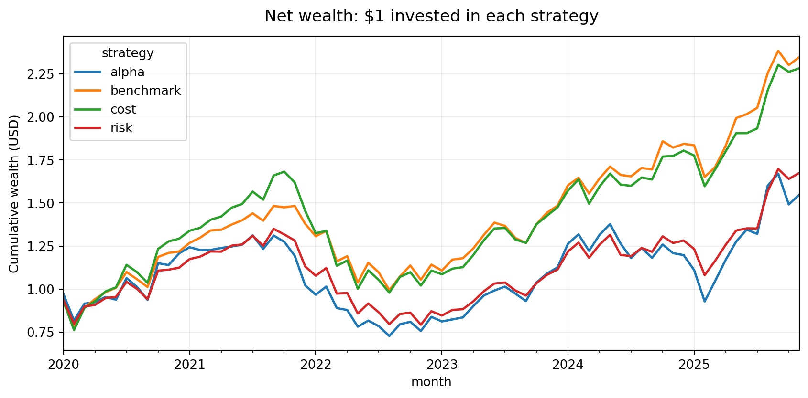
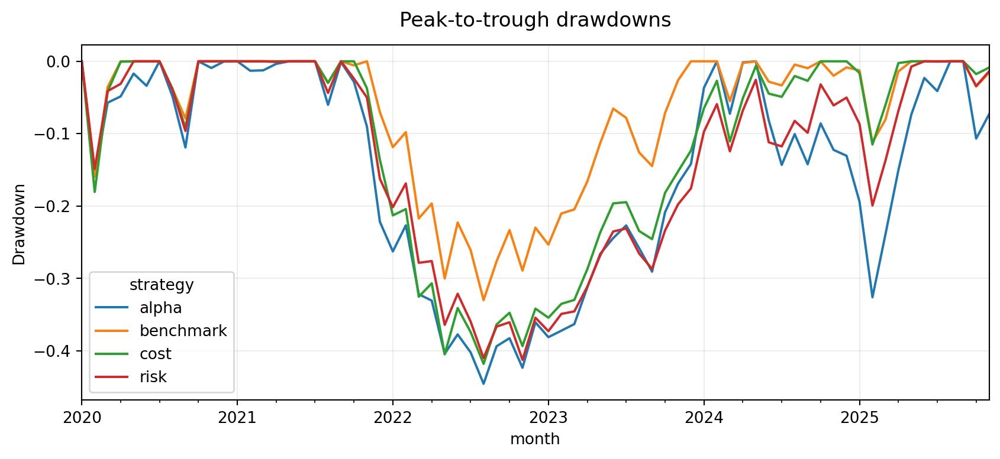
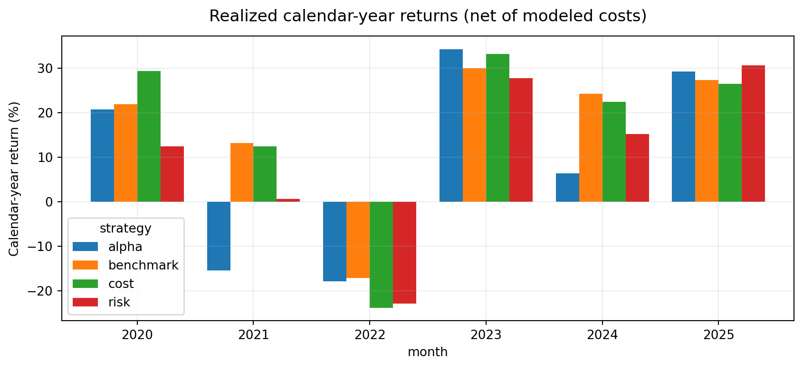
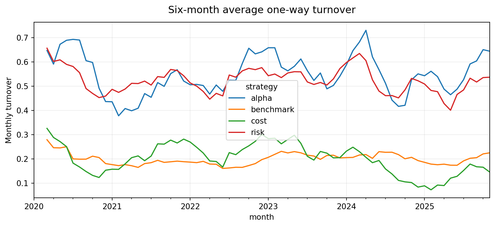
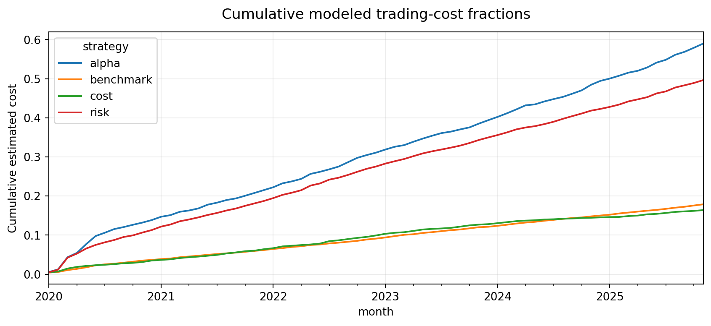
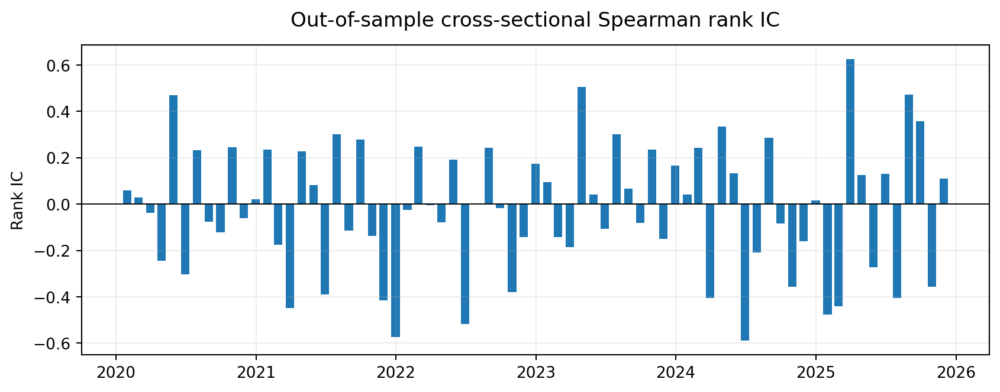
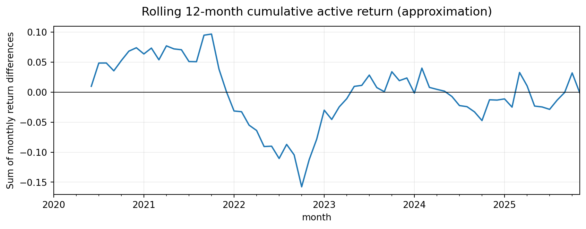
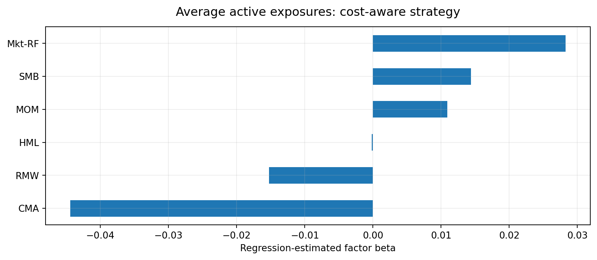
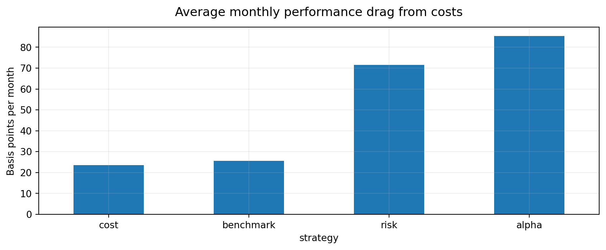
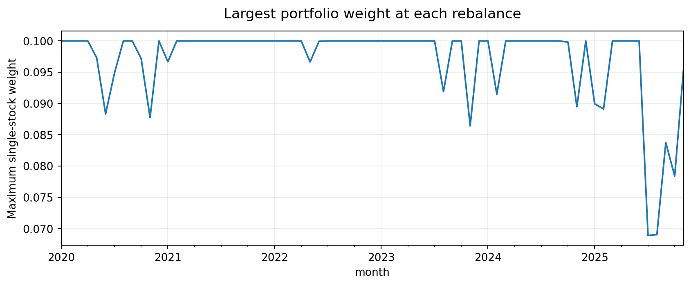

# Historical Research Findings — Final Look-ahead-Audited Run

This report records the actual user-provided daily US equity price data and French factor inputs, not synthetic market returns. It is a **survivor-universe** experiment using only today’s S&P 500 constituents, rather than an investable 2020 security master. Monthly forecasts at each month-end close enter at the first open of the following month. Only fully matured historical target returns are included in each Ridge training set (latest training signal month: t−2). Pretrade holdings in subsequent optimizations are drifted using price data available through the new decision close, rather than using future next-opening returns.

**Empirical sample:** 71 decisions (January 2020 to November 2025), 40 liquid stocks per month, 503 unique names in source panel, 1,444,124 real price records (2015–2026), 2,840 security forecasts, 11,360 strategy-security weight records. Source Fama/French files use the Sept 2026 vintage, and industry returns are real value-weighted industry aggregates.

## 1. Portfolio return outcomes

| Portfolio | Net CAGR | Annual volatility | Maximum drawdown | Average one-way monthly turnover | Zero-risk-free Sharpe |
|---|---:|---:|---:|---:|---:|
| benchmark | 15.51% | 21.81% | -32.99% | 20.08% | 0.773 |
| alpha | 7.67% | 27.45% | -44.55% | 55.01% | 0.404 |
| risk | 9.10% | 23.07% | -41.25% | 52.06% | 0.493 |
| cost | 14.97% | 23.88% | -41.80% | 19.80% | 0.707 |

**Finding:** The cost-aware strategy has lower turnover than the alpha-only and factor-risk-only portfolios but slightly underperforms the matched equal-weight benchmark on compound returns. The benchmark also has a materially smaller maximum drawdown than the cost-aware optimizer. Lower rebalancing activity does **not** prove extra predictive alpha.

## 2. Alpha model: information coefficient

Monthly cross-sectional Spearman rank IC averages **-0.0193** (HAC t = -0.823, p = **0.410**), with 35 positive months out of 71. This fails to establish positive return-forecasting skill.

| Portfolio | Annualized active mean (arithmetic) | Information ratio | HAC p-value | 95% HAC interval for **monthly** active mean |
|---|---:|---:|---:|---:|
| alpha | -5.79% | -0.440 | 0.251 | [-1.306%, 0.342%] |
| risk | -5.49% | -0.795 | 0.027 | [-0.864%, -0.051%] |
| cost | -0.00% | -0.000 | 0.999 | [-0.394%, 0.393%] |

Information ratio and active return are relative to the **matched dynamic 40-stock basket**, not the conventional capitalization-weighted S&P 500 index. HAC inference uses three lags. Statistical significance is neither guaranteed nor established by cumulative wealth differences.

## 3. Six-factor regression

Returns net of the correctly aligned *holding-month* RF are regressed on Fama/French market, size, value, profitability, investment, and momentum factors. The annualized intercept is a descriptive regression intercept, not authenticated proprietary alpha.

| Portfolio | Annualized regression intercept | HAC intercept p-value | Regression R² |
|---|---:|---:|---:|
| benchmark | -0.14% | 0.945 | 0.910 |
| alpha | -4.83% | 0.380 | 0.659 |
| risk | -4.70% | 0.177 | 0.811 |
| cost | -1.34% | 0.695 | 0.849 |

## 4. Sensitivity under alternative trading-cost multipliers

The following holds **optimized weights fixed** at the base estimates, multiplies the realized trading-cost fractions by the indicated scalar, and recomputes portfolio wealth. It is a cost-accounting sensitivity check, not a new optimization at each fee level and not a true broker-execution estimate.

| Cost multiplier | Benchmark net CAGR | Cost-aware net CAGR | Alpha-only net CAGR | Risk-only net CAGR |
|---|---:|---:|---:|---:|
| 0× | 19.06% | 18.21% | 19.02% | 18.70% |
| 0.5× | 17.28% | 16.58% | 13.22% | 13.81% |
| 1× | 15.51% | 14.97% | 7.67% | 9.10% |
| 1.5× | 13.78% | 13.38% | 2.36% | 4.57% |
| 2× | 12.06% | 11.81% | -2.71% | 0.21% |
| 3× | 8.70% | 8.73% | -12.18% | -8.03% |

## 5. Regime sample splits

These descriptive splits are based on **decision month**, with modeled positions entered in the following calendar month; they are not independently validated subperiod model discoveries.

| Decision months | Benchmark CAGR | Alpha CAGR | Risk CAGR | Cost-aware CAGR |
|---|---:|---:|---:|---:|
| 2020_2022 | 4.53% | -5.68% | -4.47% | 3.46% |
| 2023_2025 | 28.01% | 23.37% | 25.08% | 28.14% |

## 6. Figures (all sourced from actual uploaded observations)

## 7. Interpretation and remaining bias

The public-data technical/peer Ridge forecast does not demonstrate positive ranking information in this particular experiment. Risk-aware constraints do not automatically produce better realized risk-adjusted returns. Explicitly penalizing trading does reduce turnover and assumed costs, but there is no significant net active return. These negative-to-mixed findings are the results of the project, not a failure of software execution.

The historical price panel omits removed/delisted constituents; use of revised-vintage adjusted prices, incomplete opening auction data, model-chosen impact coefficients, no shorting, a benchmark constructed from today’s surviving names, no security-level fundamentals or quotes, and the absence of nested parameter cross-validation severely limit external validity. This is a technical **research methodology and test harness**, not an Acadian product or an authenticated trading strategy.
